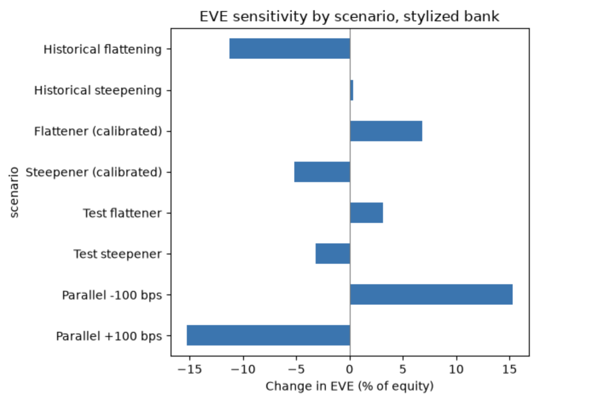

# bank-rate-risk-model

A model of how a stylized Canadian bank's earnings (net interest income, NII) and equity value (economic value of equity, EVE) respond to interest rate shocks, built from Bank of Canada yield data and checked against RBC's fiscal 2025 disclosures.



## Why it matters
A bank borrows short and lends long. When rates move, its earnings and the value of its equity can move in different directions. Asset-liability management (ALM) teams measure this and keep it within limits. This project builds a small version of that measurement.

## What I built
- **Data:** daily Government of Canada benchmark yields (2, 3, 5, 7, 10-year) from the Bank of Canada Valet API, 2015-01-01 to 2026-10-29.
- **Balance sheet:** a six-line banking-book bank of $100B in assets, scaled from RBC's 2025 balance sheet (deposits about 90% of funding, equity 8%).
- **Excel prototype:** the full model with a rate shock switch (`model/bank_balance_sheet.xlsx`).
- **Python engine (`src/alm.py`):** NII from repricing gaps and deposit betas, EVE from duration, and non-parallel scenarios through key-rate exposures at the 2, 3, 5, 7, and 10-year points.
- **Scenarios:** parallel shocks, steepeners and flatteners, and historical windows taken from the yield data.
- **Tests:** `pytest` suite that reproduces the Excel results.
- **Validation:** comparison with RBC's disclosed sensitivities.
- **PCA scenarios (src/rates.py):** level, slope, and curvature shocks derived from daily yield changes, run through the same EVE and NII engine.

## Key findings
- **Earnings and value move in opposite directions.** For a +100 bps parallel shock, NII rises by $0.084B and EVE falls by $1.22B (15.3% of equity), per $100B of assets. RBC's disclosure shows the same split.
- **The deposit beta drives the NII result.** With chequing and savings deposits passing through only 30% of a rate change, NII rises. With a beta of 1 on every deposit, the same shock lowers NII by $0.30B.
- **The curve's shape matters.** A test steepener (short rates down, long rates up, pivoting at 5 years) lowers EVE by $0.25B and raises NII by $0.02B. A flattener does the reverse. The bank is exposed to steepening because its assets are longer than its funding.
- **The yield curve was inverted on 703 business days since 2015,** including 248 of about 250 days in 2023. 
- The first three principal components explain 93.1%, 5.3%, and 0.7% of daily yield-curve variance.

## Validation against RBC
Compared with RBC's fiscal 2025 disclosure (Table 49 for sensitivities, Table 7 for net interest income of $33,000M, Table 36 for equity):

| Measure | Model | RBC |
|---|---|---|
| NII change, +100 bps (% of NII) | +3.17 | +0.60 |
| NII change, -100 bps (% of NII) | -3.17 | -1.13 |
| EVE change, +100 bps (% of equity) | -15.28 | -1.90 |
| EVE change, -100 bps (% of equity) | +15.28 | +1.39 |

The signs match in all four cases. The sizes do not: my model is several times more sensitive than RBC. RBC attributes its EVE sensitivity to net growth in fixed-rate assets, including growth in book capital. I could not verify whether hedging explains the rest of the gap. RBC's NII response is also asymmetric (+$197M and -$373M), while my linear model is symmetric.

NIM is 2.64% in my model (NII over total assets) against RBC's reported 1.62% on its own definition. Interest income is close to RBC's as a share of assets, but my funding cost is about half of RBC's. I did not recalibrate the model to close the gap.

## Limitations
- Banking book only, with no trading book, derivatives, or hedging.
- Static balance sheet: no growth, prepayments, or behavioural modelling beyond deposit betas.
- Durations, deposit betas, spreads, and the split of deposits are assumptions, not estimates.
- Duration is a linear approximation, so +100 and -100 bps responses are symmetric.
- Key-rate exposures come from a single duration per line, not from cash flows.
- A 2-year yield stands in for the policy rate on floating-rate lines.
- This is an educational model of a stylized bank, not a forecast or a model of RBC.
- PCA scenarios reflect 2015 to 2026 data and a square-root-of-time scaling; see docs/model_spec.md.

## Repository layout
```
data/yields.csv            Bank of Canada yields (frozen at 2026-10-29)
model/                     Excel prototype and balance sheet CSV
src/alm.py                 NII, EVE, and scenario engine
tests/test_alm.py          tests that reproduce the Excel results
notebooks/                 01 data pull, 02 NII engine, 03 scenarios, 04 validation
docs/model_spec.md         full model specification and assumptions
```

## How to run
```
python3 -m venv .venv
source .venv/bin/activate
pip install -r requirements.txt
python -m pytest -v
```
Then open the notebooks in order (`01` to `04`) in VS Code or Jupyter.

## Sources
Bank of Canada Valet API (benchmark bond yields). RBC 2025 Annual Report, Tables 7, 36, and 49.

## Next steps
- Simulate rate paths (Monte Carlo) to get distributions of NII and EVE